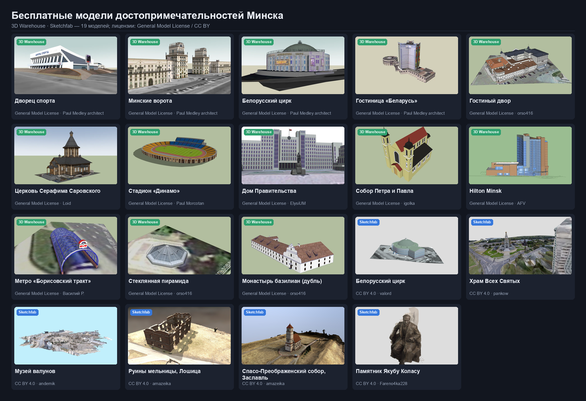

# Бесплатные 3D-модели достопримечательностей Минска

Дата обзора: 2026-11-19.

Цель: найти на 3D-площадках модели минских достопримечательностей, которых ещё нет
в проекте, с бесплатной лицензией (максимум — указание автора).

## Что уже есть в проекте

15 low-poly моделей в `assets/landmarks/low-poly`:

- Арханёл Міхаіл, які пранізвае змея
- Касцёл Святога Сымона і Святой Алены (Красный костёл)
- Кафедральны сабор Сашэсця Святога Духа
- Манумент Перамогі
- Музей гісторыі Вялікай Айчыннай Вайны
- Мінск-Арэна
- Нацыянальная бібліятэка Беларусі
- Нацыянальны акадэмічны Вялікі тэатр оперы і балета
- Нацыянальны мастацкі музей (и филиал на Карла Маркса, 24)
- Палац Рэспублікі
- Парадны ўваход у цэнтральны дзіцячы парк імя Горкага
- Ратуша
- Стэла «Мінск-Горад Герой»
- Чыгуначны вакзал станцыі Мінск-Пасажырскі

## Новые находки (которых нет в проекте)

### Sketchfab — CC BY 4.0

Лицензия: свободное использование, в том числе коммерческое, с указанием автора и ссылки.

| Достопримечательность | Модель | Автор | Полигоны | Ссылка |
|---|---|---|---|---|
| Белорусский государственный цирк | «Белорусский государственный цирк» | valord | 3 359 | https://sketchfab.com/models/ded930099f7a4f14af558667ea1103cb |
| Храм-памятник Всех Святых | «Cathedral "Church of all saints"» | pankow | 63 733 | https://sketchfab.com/models/7f86f29d38774d0b9e086da221ee15b6 |
| Музей валунов | «Музей валунов» | andemik | 1 000 000 | https://sketchfab.com/models/b6ec3e0694f64040a76f5c944c8e1c27 |
| Руины мельницы XIX в. в Лошицком парке | «Руины мельницы 19 в. в Лошицком парке» | amazeika | 391 936 | https://sketchfab.com/models/8fdaefb3b1d64448b39274b2e51eb6bb |
| Спасо-Преображенский собор, Заславль (за городом) | «Спасо-Преображенский собор в Заславле» | amazeika | 2 115 766 | https://sketchfab.com/models/adb2de663df34e87890d79f831a4e302 |
| Памятник Якубу Коласу (местоположение требует проверки) | «Jakub Kolas» | Fareno4ka228 | 630 597 | https://sketchfab.com/models/f9a13d19623348d290edad8bde12d2c4 |

Примечания:

- Цирк — готовый low-poly, лучше всего подходит под текущий стиль.
- Храм Всех Святых — фотограмметрия вместе с окружающим рельефом; храм нужно вырезать и, возможно, decimate.
- Музей валунов и руины мельницы — фотограмметрия, 0,4–1 млн треугольников, требуется decimate.
- Спасо-Преображенский собор — Заславль, не Минск; бонус для окрестностей.
- «Jakub Kolas» — скульптура писателя; в описании нет города, перед интеграцией проверить, что это минский памятник.

### 3D Warehouse — General Model License

Лицензия: бесплатное скачивание (нужен бесплатный аккаунт Trimble), коммерческое
использование разрешено, требуется сохранять указание автора и не выдавать модель
за свою; нельзя продавать как самостоятельный товар. Для проекта достаточно указать
автора.

| Достопримечательность | Модель | Автор | GLB | Ссылка |
|---|---|---|---|---|
| Дворец спорта | «Minsk Sports Palace» | Paul Medley architect | 1,7 МБ | https://3dwarehouse.sketchup.com/model/899f7077adb0a3204a9e64a1684d02c1 |
| Минские ворота | «Gateway Buildings - Minsk» | Paul Medley architect | 1,4 МБ | https://3dwarehouse.sketchup.com/model/9bbca5e8aa8176cad042295ffd3d7882 |
| Белорусский государственный цирк | «Belarus State Circus» | Paul Medley architect | 1,1 МБ | https://3dwarehouse.sketchup.com/model/1b7db42664074837637bf388c6cd1bb |
| Гостиница «Беларусь» | «Hotel Belarus» | Paul Medley architect | 0,7 МБ | https://3dwarehouse.sketchup.com/model/be20e571d31040758a0d625af8060aa1 |
| Гостиный двор | «Gostiny dvor» | orso416 | 23,5 МБ | https://3dwarehouse.sketchup.com/model/c8c5094ea142eb6774904b30cb6a8261 |
| Церковь Серафима Саровского | «Church of St. Seraphim of Sarov» | Loid | 8,4 МБ | https://3dwarehouse.sketchup.com/model/4d8aa86567630df635bb9af445502714 |
| Стадион «Динамо» | «Dinamo Stadion Minsk» | Paul Morcotan | 1,7 МБ | https://3dwarehouse.sketchup.com/model/f5bee47b442cbec7db6005c5ac76908a |
| Дом Правительства | «Минск-Дом Правительства» | ElysiUM | 0,5 МБ | https://3dwarehouse.sketchup.com/model/75c423173a2c3dda1b4979cba29c8c29 |
| Собор Петра и Павла | «Собор святых апостолов Петра и Павла» | igolka | 0,3 МБ | https://3dwarehouse.sketchup.com/model/e0efcb2a9267ca78ff1878f9badfb5c4 |
| Hilton Minsk | «Hilton Minsk» | AFV | 1,5 МБ | https://3dwarehouse.sketchup.com/model/222a03a30811efae3382a23112f0a235 |
| Станция метро «Борисовский тракт» | «Станция метро "Борисовский тракт"» | Василий Р. | 0,4 МБ | https://3dwarehouse.sketchup.com/model/cf527b6bc6278fb4b71fb0daeb416ad4 |
| Стеклянная пирамида (Верхний город) | «Glass pyramid» | orso416 | 1,6 МБ | https://3dwarehouse.sketchup.com/model/d4660dfe8348a4a4653da862c4cadcb |
| Монастырь базилиан (дубль: уже входит в модель Свято-Духова собора) | «Convent of Basilians of Holy Spirit» | orso416 | 4,0 МБ | https://3dwarehouse.sketchup.com/model/c3d2c9c14a1ee4e374904b30cb6a8261 |

Альтернативы:

- Стадион «Динамо»: https://3dwarehouse.sketchup.com/model/dfff13e93d901dcf347814f89ccefaab (Daniel M., 0,4 МБ, с аэрофото-подложкой).
- Площадь Независимости (без превью, качество не проверено): https://3dwarehouse.sketchup.com/model/cbd9f008-92de-41b9-b1b0-16c23e207096 (alex B.).

## Скачанные файлы

Не-фотограмметрические модели скачаны в `assets/landmarks/` (13 GLB, ~48 МБ):

`minsk-sports-palace.glb`, `minsk-gates.glb`, `belarus-state-circus.glb`,
`hotel-belarus.glb`, `gostiny-dvor.glb`, `church-st-seraphim-sarov.glb`,
`dynamo-stadium.glb`, `government-house.glb`, `peter-and-paul-cathedral.glb`,
`hilton-minsk.glb`, `metro-borisovsky-trakt.glb`, `glass-pyramid.glb`,
`basilian-monastery.glb`.

Метаданные (автор, лицензия, ссылка, хеш, размер): `assets/landmarks/DOWNLOADS.json`.
Все 13 файлов проверены импортом в Blender 5.1 headless — импортируются без ошибок.

Не скачано:

- Цирк со Sketchfab (valord) — API отдаёт 401 без авторизации; в папке лежит
  версия цирка с 3D Warehouse.
- Фотограмметрия (Храм Всех Святых, Музей валунов, руины мельницы, Заславль,
  памятник Якубу Коласу) — по условию не качалась.

## Дубликаты существующих моделей (можно обновить)

Это не новые достопримечательности, но на 3D Warehouse есть более детальные версии
того, что уже стоит в проекте:

| Объект | Автор | Ссылка |
|---|---|---|
| Национальная библиотека | ruslan.ok | https://3dwarehouse.sketchup.com/model/429a39bc1606777fa98bcb59e72eef9d |
| Театр оперы и балета | Paul Medley architect | https://3dwarehouse.sketchup.com/model/5a4f0a1a5d39febc4a9e64a1684d02c1 |
| Железнодорожный вокзал | Paul Medley architect | https://3dwarehouse.sketchup.com/model/7375995d7b4039b94a9e64a1684d02c1 |
| Дворец Республики | Paul Medley architect | https://3dwarehouse.sketchup.com/model/ea44451381e73fe78a0d625af8060aa1 |
| Ратуша | orso416 | https://3dwarehouse.sketchup.com/model/1873c2012bb228a54653da862c4cadcb |
| Минск-Арена | ElysiUM | https://3dwarehouse.sketchup.com/model/d3533a7442f72bfd1b4979cba29c8c29 |
| Монумент Победы | ElysiUM | https://3dwarehouse.sketchup.com/model/e1008cfc0f40e6f31b4979cba29c8c29 |
| Красный костёл | ElysiUM | https://3dwarehouse.sketchup.com/model/53b0ef38f13d083f1b4979cba29c8c29 |
| Свято-Духов собор | orso416 | https://3dwarehouse.sketchup.com/model/a9b606fc1e4e9e84b682ad2f5a27242d |

## Чего нет бесплатно (проверено)

Для этих объектов бесплатных моделей на площадках не нашлось:

- Дворец Независимости
- Мемориал «Остров слёз»
- Театр им. Янки Купалы
- Театр им. Максима Горького
- Комаровский рынок
- Лошицкая усадьба (нашлись только руины мельницы)
- Костёл Святого Иосифа
- Костёл Святого Роха
- Костёл Воздвижения Святого Креста
- Церковь Александра Невского
- Троицкая церковь на Золотой Горке
- Чижовка-Арена
- Ледовый дворец
- Минский зоопарк
- Ботанический сад
- Пищаловский замок
- Национальный исторический музей
- Дом масонов
- Кафедральный костёл Имени Пресвятой Девы Марии
- Минский планетарий

## Проверенные площадки

| Площадка | Результат |
|---|---|
| Sketchfab | 6 бесплатных моделей (CC BY): 4 в Минске, 1 в Заславле, 1 требует проверки |
| 3D Warehouse | 12 новых бесплатных моделей (General Model License) + 1 дубль, 9 дубликатов существующих |
| CGTrader | 145 моделей по запросу Minsk, бесплатных — 0 |
| TurboSquid | бесплатных достопримечательностей не найдено (в выдаче платные city maps) |
| Free3D | только платные city maps ($49–$149) |
| 3DExport / RenderHub | платные city maps |
| Poly Pizza | 0 моделей |
| GrabCAD | по запросу Minsk достопримечательностей не найдено (в основном техника) |
| Thingiverse / MyMiniFactory | 0 моделей |
| Printables / Cults3D | автоматический доступ заблокирован, не проверены |
| 3ddd / 3D Sky | интерьеры и квартиры, не достопримечательности |

## Лицензии

- **CC BY 4.0 (Sketchfab)** — можно использовать и изменять, в том числе коммерчески;
  обязательно указать автора, ссылку на модель и лицензию.
- **3D Warehouse General Model License** — бесплатное скачивание после регистрации;
  коммерческое использование разрешено; нужно сохранять указание автора и не убирать
  логотипы/товарные знаки с модели; нельзя продавать модель как самостоятельный товар
  и использовать в логотипе компании.

## Рекомендация по интеграции

1. В первую очередь брать low-poly цирк со Sketchfab (3,4 тыс. треугольников) — он
   ближе всего к текущему стилю.
2. Дворец спорта, Минские ворота, гостиница «Беларусь», Дом Правительства, собор
   Петра и Павла и стадион «Динамо» с 3D Warehouse — компактные GLB (0,3–1,7 МБ),
   хорошо подходят для города.
3. Фотограмметрию (Храм Всех Святых, Музей валунов, руины мельницы) предварительно
   decimate-ить и обрезать по границам объекта.
4. Для интеграции использовать существующий пайплайн `scripts/landmarks/fit_placements.py`
   и `scripts/landmarks/bake_landmarks.py`.
