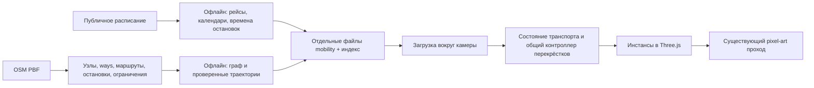

# Видимый общественный транспорт в VoxelMinsk

Исследование от 16 ноября 2026. Проверены рабочие файлы на `feat/road-normalization`, HEAD `cc53576`, включая существующие незакоммиченные данные B-2. Реализация движения и измерения его FPS в эту работу не входят.

План реализации с этапами и критериями готовности: [общественный транспорт и светофоры](superpowers/plans/2026-11-16-public-transport-signals.md).

## Вывод

**Реализуемо в нынешнем Three.js-приложении, с сохранением статического хостинга.** Наиболее полезный первый результат — узнаваемые автобусы и трамваи, едущие по проверенным траекториям, замедляющиеся перед остановками и стоящие на них. Начать стоит с автобуса в центральном видимом коридоре и отдельного трамвайного участка: трамвайные пути пилота находятся преимущественно к юго-востоку от его центра.

**Согласованный объём после уточнения пользователя:** географически обоснованные маршруты и остановки, **симуляция на основе публичного расписания**. Расписание входит в первый рабочий вариант. Реальные GPS-позиции исключены из объёма. Условные интервалы допустимы только в технической проверке рендера и не заменяют расписание в готовой функции.

Система светофоров обязательна для общественного транспорта и автомобилей; при добавлении пешеходных переходов она управляет и пешеходными фазами. Первые немногочисленные прохожие ходят только по тротуарам рядом с камерой, без пересечения проезжей части.

Для города нельзя привязывать стоимость симуляции ко всем 437 тайлам: активна ограниченная область вокруг камеры; вне её остаётся компактное состояние маршрута или расчётная фаза рейса.

## Что действительно есть в проекте

| Компонент | Состояние и значение |
|---|---|
| Рендеринг | React 19, Three.js `^0.180.0`, ортографическая камера, низкое внутреннее разрешение и общий depth/postprocess. Дополнительный движок не требуется. |
| Дороги | В проверенных payload 0.4.3 массив `roadNetwork` пуст. Оси, ширины и направления находятся в `ground.strokes`; мостовые штрихи — также внутри `ground.decks[].s`. Старое описание `roadNetwork` в README не отражает текущие тайлы. |
| Топология | `road_graph.py` строит граф для оформления перекрёстков, но не экспортирует готовую сеть движения. Связность по XY без полноценного учёта уровней недостаточна для навигации. |
| Остановки | `CrossingCollector` извлекает трамвайные остановки/платформы. Автобусные точки и общая семантика остановок не доведены до отдельного runtime-слоя. Нарисованная платформа — ещё не точка остановки машины. |
| Маршруты | `RelationCollector` принимает multipolygon/boundary, пропуская `type=route`, `route_master` и `restriction`. Нужные маршрутные отношения в исходном PBF есть. |
| Поток данных | Worker преобразует tile JSON в геометрию/текстуры. `TileWirePayload` не передаёт исходные дорожные линии на главный поток. Нельзя просто прочитать маршруты из загруженного scene group. |
| Массовые объекты | `instancedTrees.ts` демонстрирует общий кеш геометрии, инстансинг и освобождение ресурсов. Подход пригоден и для транспорта, но динамическим объектам нужны свои буферы и lifecycle. |
| Город | `/data/city-tiles`, который выбирает `?dataset=city`, локально содержит **437 тайлов**, а `/data/city-tiles-current` — старый снимок на 144. Названия каталогов не определяют активный набор. |

## Проверка исходных данных

Выполнен воспроизводимый аудит: [скрипт](../scripts/qa/mobility-feasibility.py), [полный JSON](MOBILITY_DATA_AUDIT_2026-11-16.json).

Источник — локальный `data/raw/Minsk.osm.pbf`, 35 145 284 байта; SHA-256 совпал с метаданными `city_raw_b2.geojson`: `da3ccdb434f90d6a55723950167e9d93dbbb27ff063a8d8da3588a74b61663f8`. Дата извлечения B-2 — 10 ноября; это не подтверждение актуальности каждого маршрута на 16 ноября.

| Данные | Пилот, 1,6 × 1,6 км | Город, область B-2 |
|---|---:|---:|
| Автобусные отношения `route=bus` | 41 | 384 |
| Различные непустые номера `ref` у этих отношений | 23 | 195 |
| Троллейбусные отношения | 26 | 127 |
| Различные `ref` троллейбусов | 16 | 65 |
| Трамвайные отношения | 4 | 14 |
| Различные `ref` трамваев | 2 | 7 |
| Точки `highway=bus_stop` | 30 | 2 300 |
| Точки `railway=tram_stop` | 4 | 76 |
| Точки `public_transport=stop_position` | 36 | 2 437 |

Границы пилота здесь именно ±800 м, а не весь квадрат его крайних тайлов. Отношение учитывалось, если хотя бы один его highway/railway way пересекает область. Отношения могут уходить за границу; направления, варианты и пригородные рейсы учитываются отдельно. Категории остановочных точек пересекаются и **не суммируются**. Полигональные платформы этим подсчётом не охвачены. Целостность маршрутов, порядок их членов и наличие всех внешних участков пока не проверены.

В пилоте найдены трамвайные отношения `7568954`, `7568955`, `7571260`, `7571261` с `ref=1/7`. Это кандидаты для проверки геометрии, а не утверждение об актуальной схеме движения.

## Симуляция из публичного расписания

Публичное расписание задаёт рейсы, дни их выполнения, порядок остановок и плановые прибытия/отправления. OSM и проверенные корректировки задают геометрию пути. Браузер рассчитывает движение между остановками с торможением, стоянками, сигналами светофоров и очередями.

До реализации движения проверить получение полного расписания хотя бы для одного выбранного маршрута: оба направления, будни/выходные, даты действия, изменения по отдельным дням, рейсы после полуночи. Привязать идентификаторы/названия остановок источника к точкам на карте; совпадение имени само по себе недостаточно.

Предпочтительная поставка — офлайн-импорт и нормализация расписания в статические версионированные файлы с датой получения, периодом действия и адресом источника. Браузер загружает нужную дату и маршруты. GTFS Schedule подходит как входной формат, но **наличие GTFS у источника не является условием**: при другом публичном формате нужен адаптер. Сохранять оригинал загрузки и отчёт об ошибках сопоставления. Обновление данных отделить от render loop.

На официальном сайте Минсктранса есть раздел расписаний. Страница `lookout_yard` при двух попытках чтения инструментом вернула timeout; машинный интерфейс, свежесть и разрешённое переиспользование не проверены. Найденный сторонний `Semigradsky/minsktrans-api` архивирован в 2022 году: это подсказка о прежних форматах, не готовая актуальная интеграция. Проверка поддерживаемого публичного расписания остаётся первой незакрытой зависимостью; GPS-источник не требуется.

Правила модельного времени:

- Использовать дату, календарь обслуживания и часовой пояс расписания. Отдельно обрабатывать продолжение рейса после полуночи; смена календарного дня не должна обрывать машину.
- При открытии карты вычислять плановую фазу уже идущего рейса и создавать видимые машины на соответствующих участках, а не запускать все с конечной одновременно.
- Между остановками выбирать правдоподобную целевую скорость по расстоянию и доступному времени, с ограничениями скорости и ускорения. При раннем прибытии ждать планового отправления на остановке.
- Красный сигнал, очередь и свободный выезд обязательны даже при опоздании. Переносить накопленную задержку на следующие участки; не телепортировать и не ускорять машину сверх лимита ради точного совпадения с расписанием.
- Вне активной области допустим расчёт плановой фазы; согласовывать его с сохранённой задержкой при возвращении камеры. Пересоздавать/согласовывать состояние за пределами видимости.
- Если расписание просрочено или не сопоставилось с геометрией, показывать состояние данных и исключать проблемные рейсы; не подменять их произвольной частотой незаметно для пользователя.

## Предлагаемая архитектура

**Сеть движения формировать до визуальных упрощений.** Сохранять исходные node/way/relation ID, порядок членов, роли остановок, направления, bridge/tunnel/layer, разрешения доступа и ограничения поворотов. `KEEP_TAGS` сейчас не сохраняет весь этот набор. Транспортные маршруты и автомобильная сеть должны иметь общий пространственный контракт, но могут поставляться разными небольшими файлами.

Предлагаемый контракт, ещё не реализованный:

- `mobility/manifest.json`: версия, origin/CRS, границы, пространственный индекс, адреса chunks и маршрутов, provenance.
- Направленное ребро: стабильный ID, `from/to`, исходный way, разрешённые виды движения, полилиния `[x,y,height]`, длина и накопленные расстояния, ширина/полосы, level, допустимые продолжения.
- Остановка: стабильный ID, тип, координаты платформы, привязанное ребро/полоса и расстояние вдоль него. Точка посадки людей и положение центра автобуса различаются.
- Вариант маршрута: mode/ref/direction, упорядоченные рёбра, остановки в порядке следования, отметка проверенности.
- Рейс: ID источника, вариант маршрута, календарь/исключения, времена прибытия и отправления по остановкам, часовой пояс и период действия. Время рейса поддерживает переход через полночь.
- Светофорный узел: ID, группы сигналов, стоп-линии, разрешённые манёвры, конфликтные зоны и фазы. Один runtime-контроллер управляет видимыми сигналами и допуском транспорта/пешеходов.

Глобальный компактный индекс предотвращает разрывы маршрутов при выгрузке визуальных тайлов. В ближних chunks нужны внешние ссылки и небольшой запас соседних рёбер. Нельзя считать 64-метровые дубли `ground.strokes` разными дорогами или порождать по одному автобусу на каждый такой дубль.

В runtime нужен отдельный `MobilityLayer` с `update/dispose`, подключённый к `createCityApp.tick()`. При 10–20 шагах симуляции в секунду отображение интерполируется каждый кадр; шаг фиксированный, число догоняющих шагов ограничено. Это проектный выбор, который надо проверить измерениями. Для инициализации и далёких участков рейса можно вычислять плановую фазу аналитически; в активной области движение последовательно учитывает сигналы, очереди и накопленную задержку.

UI управляет слоями через `CityAppHandle`; React не обновляет координаты каждого агента. Фаза моделируемого рейса не зависит от загрузки тайла. Ползунок освещения не должен случайно телепортировать машины; связь суточной плотности и времени задаётся отдельно.

## Особенности разных видов транспорта

| Вид | Реализация и ограничения |
|---|---|
| Автобус/электробус | Общий дорожный follower, различающиеся силуэты/цвета. Начать с цельного кузова, тёмной полосы окон, колёс и условного табло. Повороты проверять по всему габариту, а не только по центральной точке. |
| Троллейбус | Тот же дорожный follower; штанги дают узнаваемый силуэт. Точное следование контактной сети требует отдельной геометрии проводов; в текущем tile-контракте её нет. |
| Трамвай | Следовать исходному пути с сохранённым направлением. `normalize.py` объединяет линии и удаляет близкие пути по Hausdorff ≤3,5 м для изображения рельсов; эти линии теряют часть исходной семантики. Нельзя автоматически пустить встречные вагоны по одной упрощённой оси. При необходимости локально согласовать отображение двух путей с движением. |
| Сочленённые машины | Секции размещать по разным расстояниям вдоль пути, чтобы каждая имела свою ориентацию. Одна длинная коробка на резком повороте срежет тротуар. Отдельный этап после цельного транспорта. |
| Железнодорожные поезда | Возможны на проверенных наземных участках; длина состава, стрелки и переезды усложняют задачу. В первый общественный транспорт не включать. |
| Метро | Подземные пути уже исключаются из поверхности. Для обычного вида сверху полезны входы и люди рядом; изображать поезда поверх улиц неправильно. |

На мостах нужна та же функция высоты/рамп, что у дорожного покрытия, либо подготовленный совпадающий профиль. Одного `bridge=true` недостаточно. Если исходный маршрут уходит в туннель, объект скрывается на портале, а не едет поверх здания.

## Видимость и производительность

При внутренней высоте 360 px и `orthoHeight=420` масштаб равен `2 × 420 / 360 = 2,33 м/px`. Автобус длиной 12 м занимает максимум около 5 px вдоль экрана, а при другом направлении — меньше. Транспорт уже способен создавать заметное движение, но читаемые номера маршрутов требуют приближения или отдельной карточки.

Начальные экспериментальные ограничения для **активной области**, не измеренная ёмкость: до 20 единиц общественного транспорта на desktop, до 8 на mobile; общее ограничение вместе с машинами/людьми см. отдельное исследование. Собирать инстансы по модели и материалу, используя vertex colors/instance colors; без отдельных материалов на каждое табло. Для мобильного — меньше моделей и отключаемые тени.

Не копировать статические тени деревьев буквально: сейчас shadow map обновляется по изменениям камеры/света/тайлов. Движущиеся casters потребуют регулярного обновления общей карты теней. Для первого этапа предпочтительны дешёвые нарисованные под объектом тени; избежать обновления теней всего города каждый кадр. При перемещении инстансов должны обновляться буферы и корректные bounds: старые границы batch приводят к внезапному исчезновению объектов.

Существующий `docs/B2/LOAD_PROFILE.json` показывает старый прогон на 400 резидентных тайлах: последние счётчики около 926 MiB geometry и 50 млн triangles за кадр. Это исторические render-счётчики, а не доступный запас, не уникальные треугольники и не новый замер. Динамический слой не решает уже описанную проблему обзорного LOD города.

## Реалистичная последовательность работ

Оценки ниже — ориентиры в человеко-днях для одного разработчика, при простых процедурных моделях и проверке ограниченного района. Это не обещание срока; массовая очистка OSM и точное воспроизведение автопарка не включены.

1. **Проверка публичного расписания и его привязки:** получить рейсы выбранных маршрутов, календарь и времена остановок, проверить формат и обновление. Срок адаптера оценить после получения образца; эта зависимость обязательна для первого рабочего варианта.
2. **Общая основа, 2–4 дня:** mobility-контракт, загрузка по области, часы симуляции, инстансы, счётчики, выключатель слоя. Используется также машинами и людьми.
3. **Система светофоров, ещё 2–4 дня для проверенных узлов:** видимые автомобильные/пешеходные сигналы, фазы, стоп-линии, конфликтные зоны и разрешения. Точные длительности городских фаз не требуются; безопасный модельный цикл задаётся отдельно.
4. **Общественный транспорт на двух коридорах, ещё 3–6 дней после готовности нормализованного расписания:** автобус, трамвай, расписанные рейсы/остановки, торможение и стоянка, габариты поворотов, мостовой участок, задержки у сигналов и кросс-тайловый lifecycle. Импорт расписания в этот ориентир не включён.
5. **Расширение маршрутов и троллейбусы, ещё 5–10 дней:** импорт направлений/вариантов, отчёт о разрывах, больше проверенных трасс, совместимость с автомобильным потоком. GPS-позиции не планируются.

Общественный транспорт способен дать заметный эффект раньше полной уличной симуляции: крупные объекты и предопределённые маршруты снижают число поведенческих задач.

## Что должно подтвердить прототип

- Ни одной встречной машины на одностороннем пути; нет пересечений платформ/зданий габаритом кузова. Составной транспорт проверяется секциями.
- Один объект сохраняет ID и положение на границе тайлов; повторная загрузка не создаёт дубль. Внешние части маршрутов не требуют загрузки всего города.
- Остановки находятся на правильной стороне и направлении; стоянка и трогание выглядят естественно. На трамвайном пути совпадают видимая колея и траектория. Рейсы соответствуют дате/календарю; раннее прибытие приводит к ожиданию, задержка у красного — к модельному опозданию без скачков позиции.
- Автобусы и автомобили подчиняются общим светофорам; видимый цвет совпадает с разрешением движения, конфликтующие направления не получают зелёный одновременно. Пешеходные фазы входят в систему; первые прохожие остаются на тротуарах, переходы подключаются следующим этапом.
- Проверки неподвижной камеры и панорамирования, 4 поворота камеры, день/ночь, пиксельный/чистый режим, выгрузка/повторная загрузка, остановка/запуск приложения.
- Сравнение слоя off/on в одинаковых видах: p50/p95 frame time, CPU симуляции, draw calls, память и длительные кадры при стриминге. Реальный телефон проверяется отдельно от эмуляции touch.

## Источники

Проверены 16.11.2026; внешние страницы не подтверждают актуальность локального снимка OSM.

- [OSM: маршрутные отношения](https://wiki.openstreetmap.org/wiki/Relation:route) — структура маршрута и членов.
- [Минсктранс](https://minsktrans.by/) — официальный раздел маршрутов/расписаний; [целевая страница](https://minsktrans.by/lookout_yard) не прочитана из-за timeout.
- [GTFS: Routes, Stops & Trips](https://gtfs.org/documentation/schedule/examples/routes-stops-trips/) — разделение маршрута, остановки, рейса.
- [Three.js: InstancedMesh](https://threejs.org/docs/pages/InstancedMesh.html) — общая геометрия, обновления instanceMatrix, bounds.
- [Архивный minsktrans-api](https://github.com/Semigradsky/minsktrans-api) — исторический сторонний проект; архив с 08.12.2022.

Основные локальные места: `src/shared/types.ts`, `src/shared/config.ts`, `src/engine/createCityApp.ts`, `src/engine/tiles/{tileBuild,serialization,tileStreamer,instancedTrees}.ts`, `scripts/ingest/extract.py`, `scripts/normalize/{normalize,road_graph,road_network,ground_strokes,bridge_decks}.py`.

Отдельная оценка людей, машин и их взаимодействия: [STREET_LIFE_FEASIBILITY_2026-11-16.md](STREET_LIFE_FEASIBILITY_2026-11-16.md).
