# Осень и зима в пиксельных и воксельных городах

Референсы для Isometric Minsk. Дата: 2026-11-23.

**Дисклеймер.** В ветке уже была попытка сезонности, и она отклонена по
визуальному качеству. Этот документ — не описание того, что уже сделано, а
разбор внешних примеров: что именно в них работает и что стоит перенести.
Техническая часть — в [SEASONS_TECHNICAL_PLAN.md](SEASONS_TECHNICAL_PLAN.md).

## Главный вывод

1. **Сезон — это не фильтр и не тонировка.** Во всех хороших примерах меняется
   набор поверхностей: дороги чистят, на газонах снег лежит, на крышах — слой,
   на стенах — ничего. Одинаковое «побеление» всего кадра читается как баг.
2. **Зима в городе — это карта чистки.** Асфальт тёмный и мокрый, снег — на
   тротуарах, газонах, крышах; у бордюров — грязные валы; на перекрёстках и
   остановках — вытоптанные пятна. Именно это, а не цвет снега, делает картинку
   достоверной.
3. **Глубина важнее белизны.** Снег лежит слоями: тонкий на тротуаре, толстый
   на газоне, глубже у стен и заборов, меньше под кронами. Один плоский белый
   цвет убивает и глубину, и читаемость.
4. **Осень — это разные породы и разное время.** Не «все деревья оранжевые», а
   зелёные, жёлтые, рыжие и бурые пятна; листва опадает не в один день.
5. **Пиксель-арт требует квантования.** Края снега и листвы — ступенчатые,
   с дизерингом, а не мягкий градиент. Мягкие маски на 360 px превращаются в
   «мыло» и мерцают при движении камеры.
6. **Реальные даты — не повод удивлять.** Anno 117 добавила снег по реальной
   дате и получила жалобы «это баг», после чего выпустила хотфикс с удалением
   эффекта. Сезон должен быть ожидаемым и управляемым.

## Галерея

### 0. Warsaw IZO: наш собственный эталон — и его предел

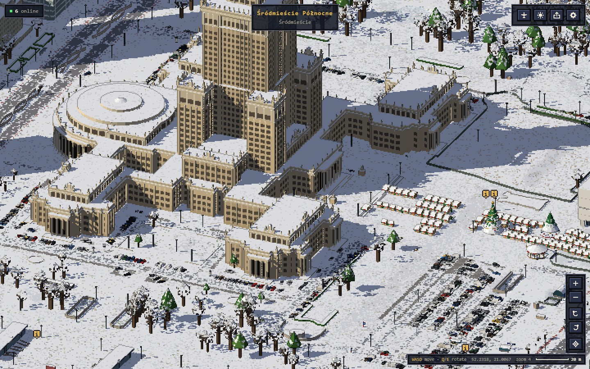

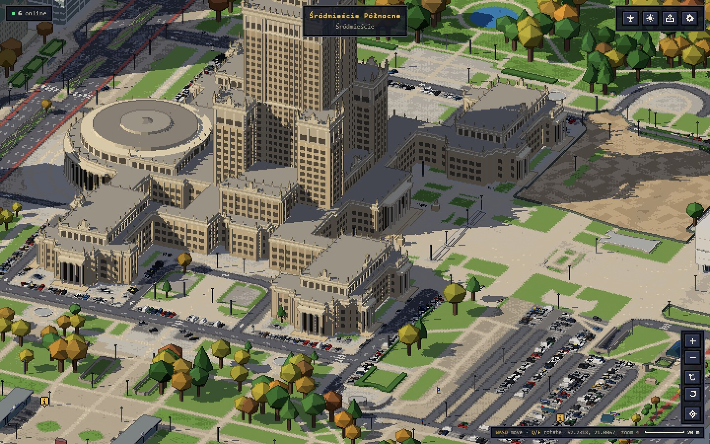

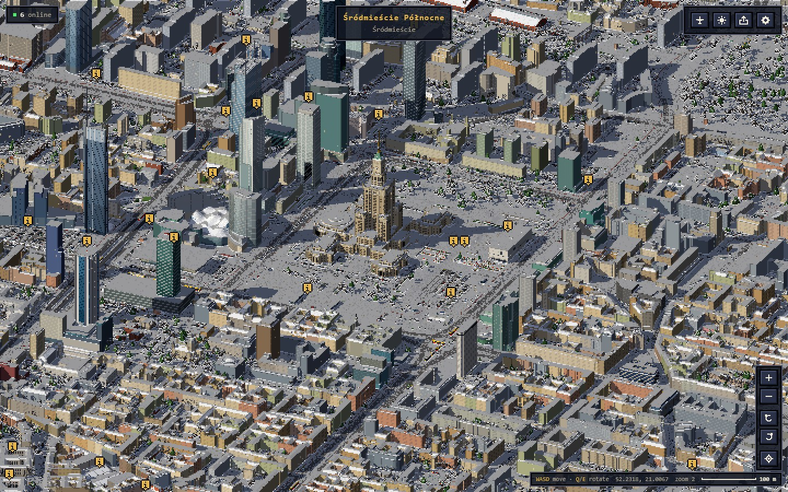

Живая карта: [bedirhanyildirim.com/warsaw-izo](https://bedirhanyildirim.com/warsaw-izo/).
Скриншоты сняты 2026-11-23 через headless-браузер; в интерфейсе есть
`Season: auto/spring/summer/autumn/winter` и живая погода со снегом.

**Что смотреть и что он делает:**

- Осень — **только палитра деревьев**: часть крон жёлтая/оранжевая, часть
  зелёная; газоны, дороги и земля не меняются, листвы на земле нет.
- Зима — снег на **всех** горизонтальных поверхностях: крыши, площади,
  газоны, парковки **и проезжая часть**. Дороги читаются только за счёт
  тёмных колеи и теней; это «свежий снег до расчистки», а не городская зима.
- Стены, стволы и вертикали чистые; лиственные деревья голые, хвойные
  зелёные; снег на ветвях.
- Снег не плоский: у него зернистая фактура и сильные холодные тени; на
  обзоре фактура превращается в серую «крупу», и город становится менее
  читаемым.
- Палитра и пиксельная сетка сохраняются; мягких градиентов нет.

**Что берём:** снег только на верхних гранях, чистые стены, голые лиственные
и зелёные хвойные, зернистую фактуру, сильные тени, дисциплину палитры.

**Что надо превзойти:** расчищенные дороги и тротуары, валы у бордюров,
жёлтую траву и листовой опад осенью, глубину снега и читаемость на обзоре.
Именно этого в Warsaw IZO нет — и именно этого ждёт городская зима.

### 1. Cities: Skylines — Snowfall: эталон городской чистки

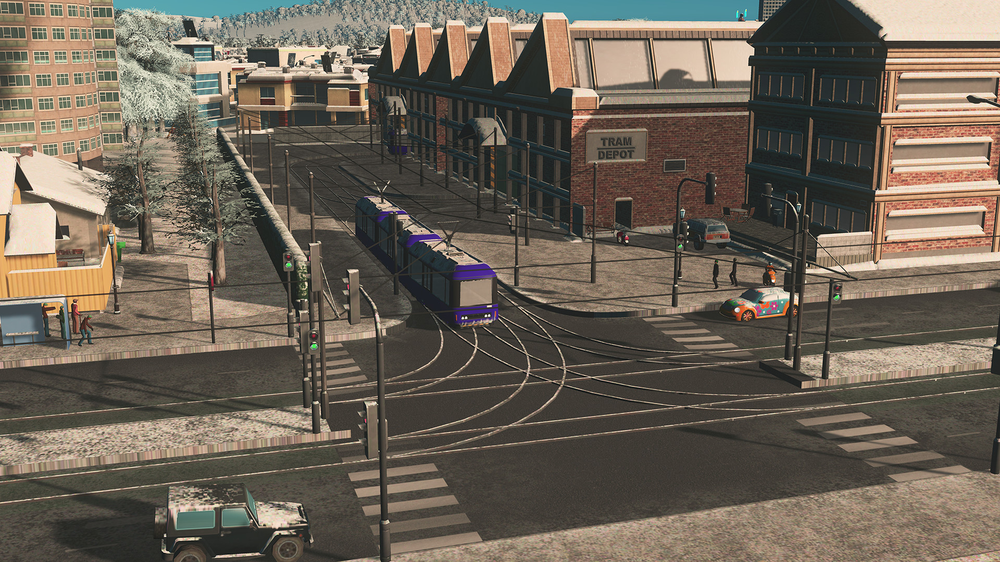

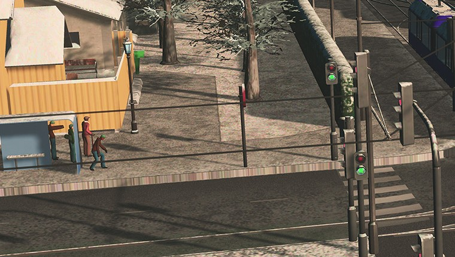

Официальные скриншоты DLC: [Cities: Skylines — Snowfall](https://store.steampowered.com/app/420610/).

**Что смотреть:** проезжая часть расчищена до тёмного асфальта, рельсы блестят;
снег остался на газонах, клумбах и тротуарах; у бордюра — вал грязного снега;
на перекрёстке видны колеи и вытоптанные полосы; крыши и козырьки припорошены,
но стены зданий чистые. Ночью снег подсвечен фонарями, а не светится сам.

**Что берём:** маску «расчищено/не расчищено» для каждого типа поверхности,
колеи на полосах, снеговые валы у бордюров, грязный снег у дороги.

### 2. Sun Haven: пиксельная зима без «белого одеяла»

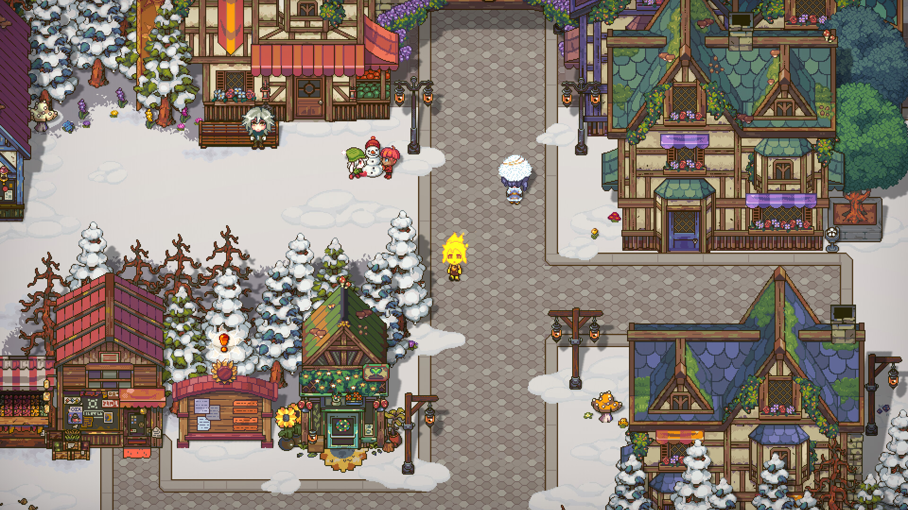

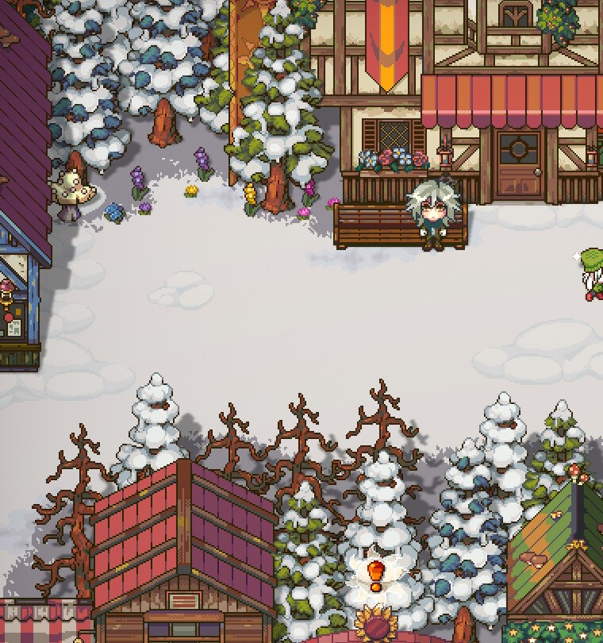

Официальный скриншот: [Sun Haven в Steam](https://store.steampowered.com/app/1432860/Sun_Haven/).

**Что смотреть:** мостовая и дорожки полностью чистые, снег лежит только на
газонах, крышах, деревьях и у стен; снег на крышах не закрывает черепицу
целиком; на газонах — сугробы с неровным краем; тёплые окна и фонари.

**Что берём:** принцип «снег только там, где его не убирают»; снег на крышах
с сохранением цвета и фактуры кровли; чёткая граница между чистым мощением и
заснеженным газоном.

### 3. Manor Lords: осень и зима на большой площади

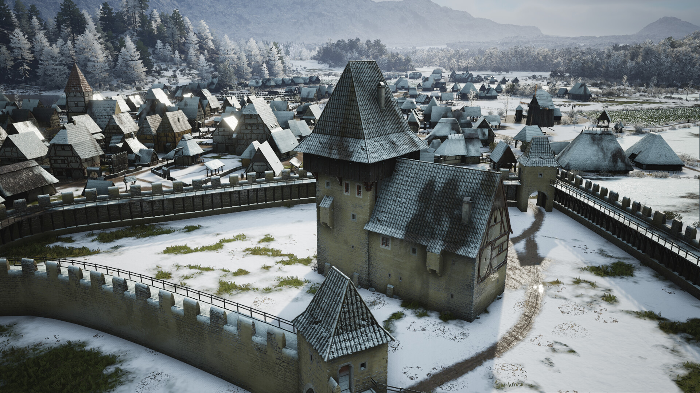

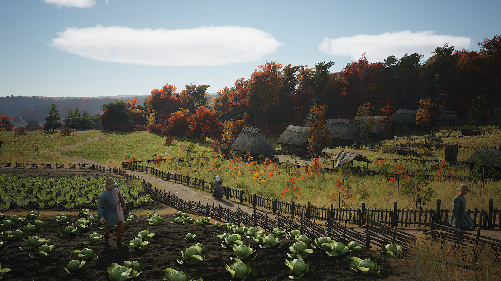

Официальные скриншоты: [Manor Lords в Steam](https://store.steampowered.com/app/1363080/Manor_Lords/).

**Что смотреть:** зимой снег лежит на крышах, полях и в дворах, но дороги и
протоптанные тропы читаются тёмными линиями; стены и башни не побелены, снег
только на горизонтальных поверхностях. Осенью — не равномерная заливка, а
пятна: зелёные, жёлтые, оранжевые, бурые; поля и трава тоже меняют цвет.

**Что берём:** снег на верхних поверхностях, тёмные тропы и дороги, осеннюю
вариативность пород, а не один общий оранжевый.

### 4. Farthest Frontier: сравнение «лето → осень» и зимний план

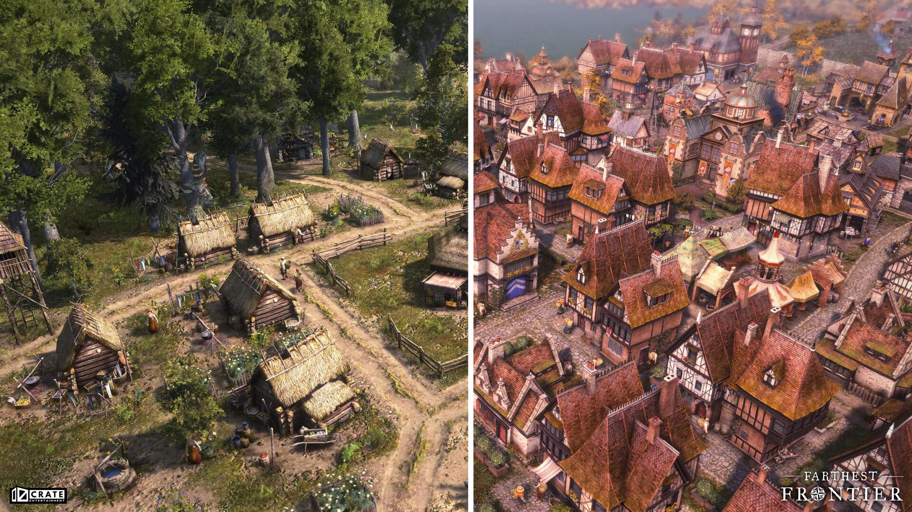

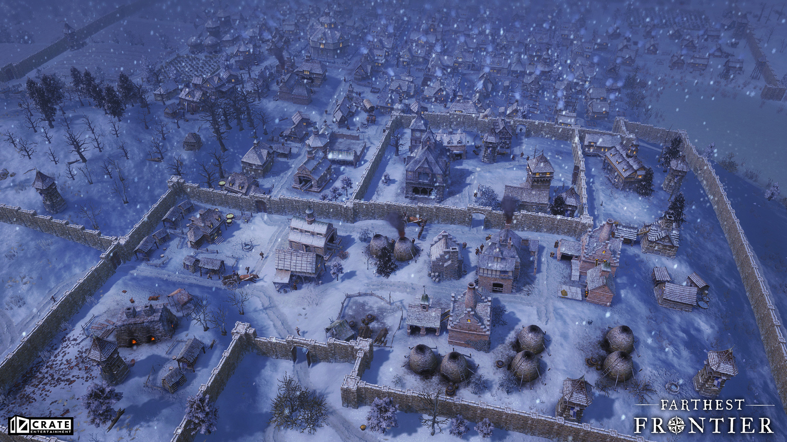

Официальные скриншоты: [Farthest Frontier в Steam](https://store.steampowered.com/app/1044720/Farthest_Frontier/).

**Что смотреть:** в осенней паре слева ещё зелёное, справа — жёлто-рыжее, при
этом архитектура и дороги не меняются. На зимнем плане снег покрывает всё, но
дороги, дворы и площади остаются более тёмными и «вытоптанными»; деревья стоят
голые, дым из труб читается.

**Что берём:** сезон меняет растительность и грунт, но не материалы зданий;
зимой город остаётся связным за счёт тёмных путей.

### 5. Banished: зимняя деревня крупным планом

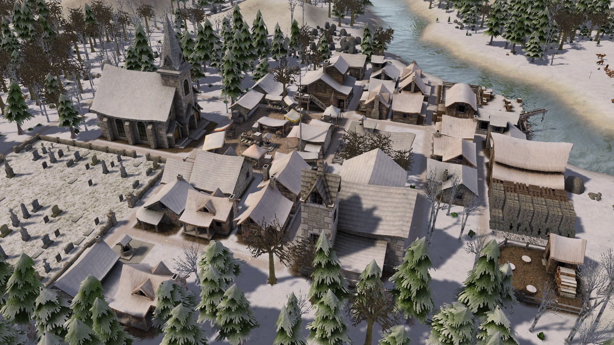

Официальный скриншот: [Banished в Steam](https://store.steampowered.com/app/242920/Banished/).

**Что смотреть:** снег на крышах и земле, но тропы и дворы протоптаны; деревья
без листвы; дым; стены домов сохраняют материал. Это пример «сплошного», но
всё ещё читаемого снега.

**Что берём:** не бояться большой площади снега, если есть сеть тёмных
протоптанных путей и чистые вертикальные поверхности.

### 6. Kynseed: пиксельная осень

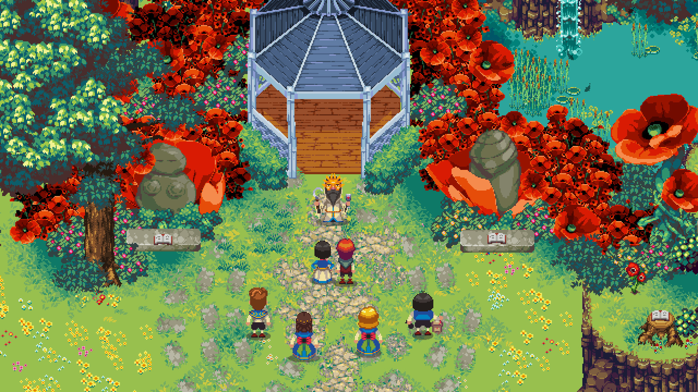

Официальный скриншот: [Kynseed в Steam](https://store.steampowered.com/app/758870/Kynseed/).

**Что смотреть:** кроны разных оттенков — от жёлтого до тёмно-красного; на
земле — осенний опад; при этом дорожка и постройки остаются читаемыми; палитра
ограничена, без фотореализма.

**Что берём:** несколько осенних палитр и разное время «поворота» деревьев;
листовой опад как наземный слой, а не как частицы по всему экрану.

### 7. Littlewood: сезон как смена тайлов и палитры

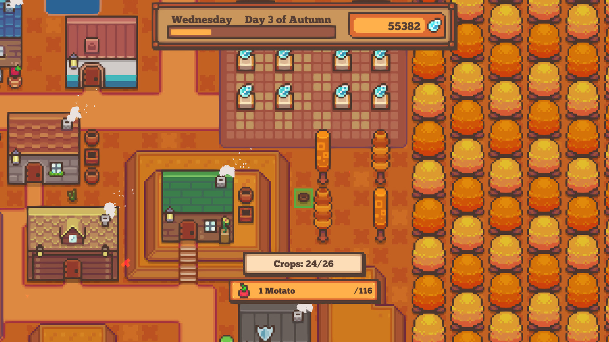

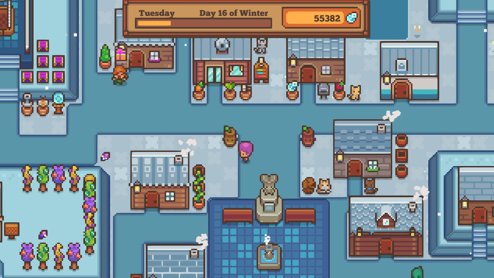

Официальные скриншоты: [Littlewood в Steam](https://store.steampowered.com/app/894940/Littlewood/).

**Что смотреть:** в кадре прямо подписаны сезоны; осенью меняется цвет земли и
крон, зимой — цвет грунта, появляются снежные кучи у построек. Это не шейдер,
а замена тайлов/палитры, но принцип тот же: сезон — это другой набор
поверхностей.

**Что берём:** дискретность и читаемость важнее плавности; снежные кучи — это
отдельные объекты/пятна, а не «потолок» белого.

### 8. Vintage Story: снег как слой, а не как цвет

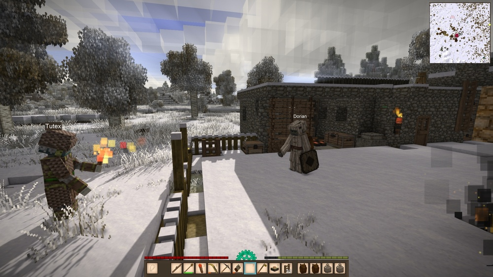

Официальная галерея: [Vintage Story — Media](https://www.vintagestory.at/media.html/).

**Что смотреть:** снег лежит слоями на блоках, крышах, заборах; у вертикальных
поверхностей его нет; глубина и края читаются; под снегом видна форма объекта.

**Что берём:** глубину/толщину как отдельный параметр; снег на верхних гранях,
но не на стенах; край снега неровный.

## Ещё несколько примеров без скриншотов

**Stardew Valley (2D-пиксель).** Зима — это отдельный `winter_outdoorsTileSheet`,
а не фильтр поверх лета; дорожки и покрытия — отдельные объекты, поэтому улицы
остаются чистыми «по конструкции», пока газоны и крыши белеют. Осенью и зимой
включается погодный слой листвы/снега (`debrisWeather`).
[Разбор сезонных тайлсетов](https://github.com/Dannode36/StardewValleyDecompiled/blob/main/Stardew%20Valley/StardewValley/GameLocation.cs#L16183).

**RimWorld (2D, не пиксель).** Самый близкий к городу пример: глубина снега
0–100%, четыре визуальные ступени (пыль 3–25%, тонкий 25–50%, средний 50–75%,
толстый 75%+) и **зоны расчистки**, где снег убирают вручную. Дороги и дворы
чистят, парки остаются под снегом.
[Snow — RimWorld Wiki](https://rimworldwiki.com/wiki/Snow).

**Обратный пример:** в Don’t Starve снег засыпает землю и «прячет дороги и
тропы» — именно этого ощущения нужно избегать.
[Snow — Don't Starve Wiki](https://dontstarve.fandom.com/wiki/Snow).

## Что покрывается снегом: рабочая матрица

| Поверхность | Зима | Осень |
| --- | --- | --- |
| Проезжая часть | Расчищена: тёмный мокрый асфальт, тонкая снежная каша у борта, колеи | Мокрый асфальт, листья только у борта |
| Трамвайные пути | Рельсы чистые, между путями — утоптанный снег | Мокрые рельсы, немного листвы |
| Тротуары | Центр расчищен/утоптан, у краёв и стен — слой 5–15 см | Листья вдоль борта и у стен |
| Бордюры, лотки | Валы грязного снега 0,3–1 м, разрывы на переходах и остановках | Листья, грязь, лужи |
| Газоны, парки | Нетронутый снег 10–25 см, сугробы у стен и заборов | Жёлто-бурая трава, листва под деревьями |
| Дворы | Въезды и тропы расчищены, снег сгребён в углы | Листья у стен, мокрый грунт |
| Крыши | Плоские — сплошной слой; крутые — пятнами; края тёмные | Мокрые, потемневшие, без снега |
| Фасады | Снега нет; мокрые потёки, снег только на карнизах/подоконниках | Мокрые потёки, тёмный цоколь |
| Деревья | Лиственные голые, снег на ветках; хвойные зелёные со снегом | Разные породы и фазы, листва на земле |
| Вода | Лёд у берегов, тёмная середина | Тёмная вода, отражения |
| Мебель, машины | Снег на горизонтальных крышках; вертикали чистые | Мокрые, листья на крышках |

## Что это значит для нас

1. **Сначала маска поверхностей, потом снег.** Нужно знать, где асфальт, где
   тротуар, где газон, где крыша, где вода. Без этого любая зима будет
   «фильтром».
2. **Расчистка важнее накопления.** Дороги, переходы, остановки, въезды во
   дворы — чистые; газоны и углы — нет. Это главный визуальный признак города.
3. **Сугробы — в конкретных местах.** У бордюров, у стен, на углах, вокруг
   столбов и заборов; не равномерным слоем.
4. **Осень — разными пятнами.** Несколько палитр, разное время, листва на земле
   у деревьев и вдоль бортов.
5. **Вертикали остаются чистыми.** Стены, столбы, стволы, машины сбоку — без
   снега; иначе город «побелел».
6. **Пиксель-арт: квантование и дизеринг.** Края снега и листвы — ступенчатые,
   без мягких градиентов; иначе на 360 px всё превращается в шум.

Перед реализацией нужно собрать 10–15 реальных фото минских улиц, дворов и
парков зимой/осенью и сверить с ними пороги: где снег, где колеи, какой
высоты валы. Без этого любая «красивая» зима снова будет выдумкой.

Детали реализации, варианты, стоимость и порядок работ —
в [SEASONS_TECHNICAL_PLAN.md](SEASONS_TECHNICAL_PLAN.md).
