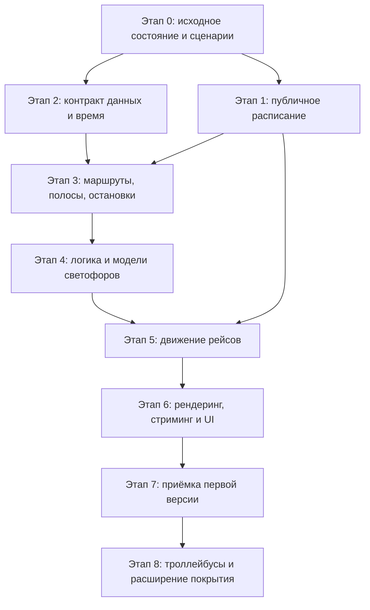

# План работ: общественный транспорт и светофоры

Дата: 16 ноября 2026. Статус: план подготовлен, реализация не начата.

Основания: [исследование общественного транспорта](../../PUBLIC_TRANSPORT_FEASIBILITY_2026-11-16.md), [исследование уличной жизни](../../STREET_LIFE_FEASIBILITY_2026-11-16.md), [аудит данных](../../MOBILITY_DATA_AUDIT_2026-11-16.json). Исходный срез — рабочее дерево `feat/road-normalization`, HEAD `cc53576`; перед реализацией проверить изменения архитектуры и данных.

## 1. Результат и согласованный объём

На карте видны автобусы, трамваи и затем троллейбусы, движущиеся по проверенным маршрутам на основе **публичного расписания**. Машины прибывают на остановки, стоят, трогаются, тормозят перед красным и могут получать модельную задержку. Видимые светофоры и разрешения движения используют общее состояние.

Первая рабочая версия:

- Один автобусный и один трамвайный маршрут: оба направления, по возможности полные трассы; обязательна непрерывная проверенная геометрия отображаемых участков.
- В каждом демонстрационном коридоре не менее трёх последовательных остановок с публичными временами, включая остановку до/после регулируемого узла.
- Минимум два проверенных регулируемых узла: обычный дорожный и узел на трамвайной трассе. Если подходящий трамвайный узел отсутствует в выбранном коридоре, выбрать другой коридор для этого сценария.
- Автомобильные, пешеходные и необходимые для выбранной трассы трамвайные группы сигналов; стоп-линии, безопасные смены фаз, остановка транспорта и освобождение перекрёстка.
- Работоспособность при перемещении камеры, пересечении границы тайлов и на мостовом участке; приоритет корректного движения перед плотностью объектов.
- Сохранение существующей полной городской карты. Ограничение покрытия движения явно описывается; карта не заменяется отдельной демонстрационной сценой.

Реальные GPS-позиции исключены. Длительности фаз светофоров модельные. Массовый поток личных автомобилей, перестроения, сочленённые кузова, точное воспроизведение контактной сети, посадка людей и переходы прохожих — последующие расширения. Несколько людей на тротуарах рядом с камерой остаются отдельной небольшой задачей и не блокируют этот план.

## 2. Зависимости и порядок



Граф отражает готовность этапов. Пока исследуется расписание, можно выполнять контракт, извлечение исходной сети и логику светофоров на небольших фикстурах. Привязка остановок к расписанию завершает этап 3. Технический прогон на вымышленных временах не принимается как готовый общественный транспорт.

Существующая работа над полной городской картой/LOD — отдельная интеграционная зависимость. Динамический слой использует актуальную схему загрузки, не переписывает ground/tree LOD и не пытается загрузить весь детальный город ради нескольких маршрутов.

## 3. Предлагаемые модули и владение данными

Пути ниже — планируемые. Перед созданием сверить с актуальным деревом, чтобы использовать уже появившиеся общие модули.

| Место | Ответственность |
|---|---|
| `scripts/mobility/import_schedule.py` | Адаптер публичного расписания, сохранение оригинала и нормализация |
| `scripts/mobility/extract_network.py` | Отдельный импорт PBF: nodes, ways, маршруты, остановки, ограничения, сигналы |
| `scripts/mobility/build_network.py` | Направленная сеть, траектории, высоты, соединения и привязка остановок |
| `scripts/mobility/export.py` | Детерминированный экспорт версионированных chunks/маршрутов/рейсов |
| `scripts/mobility/tests/` | Проверки импорта расписания и навигационного контракта |
| `data/raw/mobility/` | Оригиналы публичного расписания, дата получения, контрольные суммы; вне сайта |
| `data/processed/mobility/` | Промежуточные результаты, сверки и отчёты |
| `public/data/mobility/` | Только проверенные runtime-данные и provenance |
| `src/shared/mobility.ts` | Версии и типы контрактов без зависимостей от React/Three.js |
| `src/mobility/{clock,schedule,signals,vehicleMotion,simulation}.ts` | Чистая логика времени, рейсов, фаз, движения и занятости |
| `src/city/mobility/{vehicleGeometry,signalGeometry}.ts` | Общая стилизованная геометрия и палитра |
| `src/engine/mobility/{loader,mobilityLayer}.ts` | Загрузка по камере, кеш, Three.js-инстансы и lifecycle |
| `src/shared/appApi.ts`, `src/engine/createCityApp.ts` | Публичное управление слоем, подключение к tick/start/stop/dispose, статистика |
| `src/app/ControlPanel.tsx` | Минимальные переключатели и состояние расписания |
| `scripts/qa/mobility-audit.py`, `mobility-capture.mjs`, `mobility-perf.mjs` | Проверка данных, видео/кадры, замеры off/on |
| `tests/unit/mobility/`, `tests/e2e/mobility.spec.ts` | Поведение и проверка интеграции в браузере |
| `docs/mobility/{SOURCES,CASES,REVIEW}.md` | Источники, проверенные маршруты/узлы, результаты и ограничения |

Отдельный импорт мобильности уменьшает пересечение с уже изменяемыми `scripts/ingest/extract.py` и `normalize.py`. Общие функции проекции/высот переиспользуются, когда их контракт подходит; геометрию и правила движения не восстанавливать из растровой текстуры.

## 4. Этап 0 — зафиксировать исходное состояние и сценарии

- [x] Снять `git status`, ревизию, адреса/хеши фактически используемых manifest и параметры камеры/рендера. Уже имеющиеся изменения данных и застройки не включать в коммиты транспорта. → `docs/mobility/REVIEW.md`, раздел «Этап 0».
- [x] Для реализации выбрать изолированную ветку `codex/public-transport-signals` или рабочую копию на проверенной интеграционной базе. Учесть, что нужные B-2 данные сейчас могут отсутствовать в HEAD; не предполагать, что чистая копия HEAD эквивалентна рабочему дереву. → ветка создана от `cc53576` на рабочем дереве; данные B-2 не входят в коммиты транспорта.
- [x] Зафиксировать исходные результаты typecheck, Vitest, Python и hardware-WebGL проверок; отличать прежние ошибки от новых. → typecheck 0 ошибок, Vitest 467 passed / 5 skipped, Python 157 OK, WebGL `ANGLE/D3D11 (RTX 3080 Laptop)`.
- [ ] Создать реестр контрольных случаев: маршрут/направление, исходный ID, остановки, узлы, стоп-линии, мост, граница тайлов, фиксированные камеры. Выбрать конкретные автобус/трамвай после сверки публичного расписания. → коридоры выбраны (`scripts/mobility/corridors.json`: автобус 39, трамвай 9), узлы/мост/граница тайла ещё не внесены.
- [x] Снять off-замеры в одинаковых ближнем, среднем и городском видах. Записать устройство, GPU, разрешение, режим теней и resident-набор; эмуляция телефона не заменяет реальный телефон. → `scripts/qa/mobility-perf.mjs`, JSON-результаты в `screenshots/`, таблицы в `docs/mobility/REVIEW.md`.

**Готово, когда:** исходная карта, данные и сценарии воспроизводимы; дальнейшие сравнения относятся к одному набору настроек. Результаты фиксируются в `docs/mobility/REVIEW.md`.

## 5. Этап 1 — получить и нормализовать публичное расписание

**Статус 16.11.2026:** источник проверен и импортёр работоспособен офлайн, но условия использования запрещают переиспользование, а официального GTFS нет. Публичное расписание не получено (`scheduleStatus="unavailable"`), поэтому этап **не закрыт**; для проверки движения используется явно демонстрационное расписание. См. [SOURCES.md](../../mobility/SOURCES.md).

- [x] Проверить официальный источник расписаний Минсктранса и поддерживаемый публичный способ выгрузки. GTFS допустим, но не обязателен. Архивный сторонний API не считать актуальным источником без проверки.
- [x] Получить образец обоих направлений выбранных маршрутов: остановки, рейсы, будни/выходные, период действия и исключения. Проверить, предоставляются ли времена всех остановок или только отправления с конечной. Второй вариант требует отдельно зафиксированной модели межостановочного времени.
- [x] Записать URL, дату получения, период действия, формат, условия переиспользования и контрольную сумму оригинала. Публичная доступность страницы сама по себе не доказывает возможность повторной публикации выгрузки.
- [x] Нормализовать `routeVariant`, `stop`, `trip`, `serviceCalendar`, `stopTime`. Хранить стабильные ID источника, часовой пояс и секунды от начала дня обслуживания, включая значения за пределами 24 часов.
- [x] Сопоставить остановки по ID, координатам, направлению и порядку; неоднозначные совпадения по имени вынести в отчёт/небольшие явные overrides.
- [x] Проверить неубывание времён, существование остановок, дату/календарь и последовательность. Ошибочные рейсы не подменять случайными интервалами.
- [x] Сделать повторяемый offline-импорт, который не требует запросов к перевозчику из каждого браузера. Новый снимок сначала проходит проверку, затем заменяет старый целиком.

**Готово, когда:** для обоих выбранных маршрутов получены реальные публичные времена и воспроизводимый снимок. Если доступен только неполный источник, описание ограничений и модель промежуточных времён обязательны. Если источник недоступен, продолжать независимые этапы, но не объявлять транспорт по расписанию готовым.

**Проверки:** обычный день, выходной/исключение, переход через полночь, дубли/неизвестные остановки, несовместимые времена, смена периода действия. Фикстуры небольшие и обезличенные в части ненужных для задачи данных.

## 6. Этап 2 — контракт мобильности и общие часы

**Статус 16.11.2026: выполнено.** Контракт `src/shared/mobility.ts` (v1), часы 10 Гц с ограниченным catch-up, идентичность релиза и инвалидация кеша; 22+9 тестов.

- [x] Зафиксировать независимую от city tile payload версию мобильности, общий origin/CRS и правило `[localX, localY, height] → [worldX, height, -localY]`. → `src/shared/mobility.ts` (`MOBILITY_VERSION`, `mobilityLocalToWorld`) + `docs/mobility/CONTRACT.md`.
- [x] Определить направленные edges, lane paths, junction movements, stop bindings, signal groups/programs и их внешние ссылки между chunks.
- [x] Создать компактный глобальный индекс маршрутов и границ chunks. Полная геометрия загружается по региону камеры с запасом соседей; длины/расписания позволяют вычислять далёкую фазу без загрузки всего маршрута.
- [x] Реализовать единые часы симуляции с фиксированным шагом и ограниченным числом догоняющих шагов. Render интерполирует состояние; пауза/скрытая вкладка не вызывают длинный расчёт накопившегося времени.
- [x] Отделить время освещения от часов рейсов. По умолчанию дата/время обслуживания берутся из часов расписания; для QA поддержать явную фиксированную дату, seed и продвижение по шагам. Изменение даты/времени выполняет явную переинициализацию.
- [x] Определить идентичность релиза: хеш сети, версия расписания и привязок. Несовместимые файлы не смешиваются; кеш инвалидируется по версии, адреса учитывают Vite base.

**Готово, когда:** типы, exporter и loader понимают одну версию; один и тот же seed/входные данные дают одинаковые состояния при разных render FPS.

## 7. Этап 3 — маршруты, полосы и остановки

**Статус 16.11.2026: выполнено для геометрии.** Автобус 39 и трамвай 9 (оба направления, 0 разрывов), 197 рёбер, 50 остановок, высоты по deck-треугольникам (max ступень 0,321 м, швы 0), отчёт и аудит. Портал/модель времени за краем карты не реализованы: оба коридора целиком внутри B-2. См. [ROUTES.md](../../mobility/ROUTES.md).

- [x] Импортировать исходные node/way/relation ID, порядок/роли членов, направления, `bridge/tunnel/layer`, доступ, полосы и turn restrictions. Не использовать картографическую дедупликацию трамвайных путей как основу движения.
- [x] Собрать связность по исходной топологии и уровню. Разделить мост, дорогу под ним и туннель даже при совпадении XY. Отдельно обработать `oneway=-1` и ограничения с исключениями для общественного транспорта.
- [x] Восстановить оба направления выбранных маршрутов, внешние участки за картой и вход/выход в область. Произвольная близость линий не разрешает соединять их.
- [x] Подготовить центры полос и плавные поворотные траектории. Проверить габарит автобуса/вагона по всему повороту, допустимую поверхность и совпадение трамвайной траектории с видимыми рельсами.
- [x] Привязать платформы и положения транспорта на остановках раздельно: правильная сторона, направление, расстояние вдоль пути и место стоянки. Остановка не должна помещать кузов на зебру или в конфликтную зону.
- [x] Получить высоты из того же профиля, что у фактического мостового покрытия. Сверить с triangles/decks текущих данных; исключить ступень на границе chunks и движение поверх подземного пути.
- [x] Экспортировать отчёт: длины, разрывы, отсутствующие члены, ошибочные повороты, неподвязанные остановки, покрытие расписания. Ручные правки имеют причину и исходные ID.

**Готово, когда:** все отображаемые участки выбранных трасс непрерывны, направлены и проходят геометрический аудит; все их остановки расписания сопоставлены. Участки за рамкой имеют явную модель времени и порталы, а не движение по прямой между обрезанными концами.

**Проверки:** разрыв маршрута, двухуровневое пересечение, встречный путь трамвая, неправильная сторона остановки, габарит на повороте, высота рампы, дубль на границе тайла. Перед сигналами нужен стабильный ID манёвра, а не ссылка на временный scene object.

## 8. Этап 4 — система светофоров

**Статус 16.11.2026: выполнено, кроме QA-оверлея.** Контроллер, конфликтная матрица (116 пар, 97 фаз), удержание занятой зоны, проверка выхода и жёлтого; 44 узла в данных, 16 тестов. Диагностические ID/занятость доступны через `getMobilityDump()`, отдельного экрана-оверлея нет.

- [x] Для выбранных узлов подготовить подходы/выезды, стоп-линии, поворотные движения, переходы и группы сигналов. OSM-точка светофора служит подсказкой, схема узла проверяется отдельно.
- [x] Построить матрицу конфликтов траекторий с учётом ширины/габарита. Пешеходные и трамвайные движения включаются в неё. Для первой версии использовать защищённые повороты и консервативные фазы без сложных разрешённых конфликтов.
- [x] Реализовать чистый контроллер: зелёный, жёлтый, красный, настраиваемое освобождение перед следующим разрешением; пешеходная группа получает своё разрешение/запрет. Длительности — модельные параметры конкретного узла.
- [x] На жёлтом решение остановиться/продолжить зависит от доступного тормозного пути и границы въезда. Уже въехавший транспорт сохраняет право закончить манёвр; конфликтующий поток ждёт освобождения даже после окончания номинального интервала.
- [x] До разрешения въезда проверять свободный выход и дистанцию до впереди идущей машины. Блокированный выезд запрещает вход даже на зелёном.
- [x] Состояние/занятость узла принадлежит симуляции, сохраняется при выгрузке моделей. Периодическая фаза может вычисляться по общим часам, но её нельзя восстанавливать без учёта ещё занятой конфликтной зоны.
- [x] Создать общие low-poly модели автомобильного, пешеходного и нужного трамвайного сигнала. Ориентация и расположение относятся к подходу; огни читаются в ближнем pixel-art виде. Использовать общие материалы/emissive-поверхности без отдельного источника света на каждый сигнал. → после ручной проверки головки ставятся на тротуар справа от полосы (2,75–7,84 м от осевой), стоп-линии — по полигону перекрёстка; инварианты проверяются сборкой (`docs/mobility/REVIEW.md`).
- [ ] Добавить QA-отображение ID, стоп-линий, активных групп, траекторий и конфликтных зон. Оно выключено в обычном интерфейсе.

**Готово, когда:** видимые сигналы точно соответствуют допуску, конфликтующие движения не разрешены одновременно, завершение длинного манёвра не создаёт столкновения. Контроллер поддерживает подключение будущих автомобилей и пешеходов через общий API.

**Проверки:** все пары конфликтов на полном цикле; границы жёлтого; медленный вагон остаётся в узле; выход занят; поворот пересекает переход; пауза/возврат камеры/выгрузка не сбрасывают разрешения. Полезен небольшой тестовый второй транспорт, а не реализация массового автомобильного потока ради проверки светофора.

## 9. Этап 5 — симуляция рейсов

**Статус 16.11.2026: выполнено на демонстрационном расписании.** Путь по полосам рёбер, разгон/торможение/стоянка/очередь/сигналы, перенос задержки; 31 тест и живой прогон (12 активных рейсов при 08:00). Связка кузова между рейсами и очереди между вариантами — вне MVP.

- [x] Создавать рейсы по календарю и фактическим отправлениям. При открытии карты выбирать уже активные рейсы и вычислять их плановую фазу; все машины не стартуют с конечной одновременно.
- [x] Реализовать состояния `на участке → торможение → остановка → ожидание отправления → движение`, а также ожидание сигнала/очереди, завершение рейса и уход за край области.
- [x] Вычислять целевую скорость по расстоянию и доступному времени до следующей остановки, ограничивая скорость/ускорение/торможение. При раннем прибытии ждать отправления; при недостатке времени фиксировать опоздание.
- [x] Подключить общий сигнал/занятость к follower: остановка до стоп-линии, движение за предыдущим транспортом, въезд только при свободном выезде. Само расписание не даёт разрешения проехать красный.
- [x] Переносить модельную задержку по маршруту. Запретить скачки, развороты или ускорения сверх лимита ради «догоняния» расписания.
- [x] Вне активной области использовать фазу расписания и компактное состояние накопленной задержки. На возвращении согласовывать состояние за экраном; транспорт не возникает внутри занятой конфликтной зоны. При нехватке проверенных данных ждать до узла/исключить проблемный рейс.
- [x] Различать завершённый рейс и оборот на конечной. Один и тот же кузов связывать с новым рейсом только при наличии соответствующих данных; для MVP допустимы независимые рейсы с появлением/уходом вне видимости.

**Готово, когда:** можно пройти выбранный маршрут по расписанию с остановками и несколькими сменами сигнала, получить правдоподобное опоздание и сохранить непрерывность движения при возврате камеры.

**Проверки:** раннее/позднее прибытие, красный перед остановкой, две машины в одной полосе, рейс после полуночи, смена календаря, восстановление из невидимой области, изменение render FPS.

## 10. Этап 6 — визуальный слой и интеграция

**Статус 16.11.2026: выполнено.** Загрузчик по области камеры (33 chunk, ~1,0 МБ), инстансы с LOD/бюджетами 20/8, дешёвые тени, UI-переключатели и статус, интеграция в существующий tick без второго render loop, кадры и четыре поворота камеры.

- [x] Сделать цельный автобус и цельный вагон с узнаваемым силуэтом, окнами/колёсами и ограниченной палитрой. Точная модель автопарка и сочленения добавляются отдельно.
- [x] Собрать инстансы по модели/материалу и пространственным группам. Обновлять instance-буферы и корректные bounds; статические тайлы не пересобирать при движении машины.
- [x] Подключить `MobilityLayer` к существующему tick и lifecycle. Отмена fetch, освобождение буферов и отсутствие второго render loop обязательны. Логические ID не зависят от порядка instances.
- [x] Загружать сеть/сигналы по области камеры с запасом для торможения и видимости. Файлы рейсов кэшировать по дате/варианту; полностью невидимые маршруты не требуют всех geometry chunks.
- [x] Ограничить отрисовку: начальные ориентиры до 20 единиц транспорта на desktop и до 8 на mobile; это бюджеты для проверки. При превышении выбирать ближайшие/читаемые, сохранять логическую фазу остальных и показывать счётчик ограничения в QA. Из-за снижения бюджета не менять интервалы расписания.
- [x] Добавить экранный LOD с гистерезисом; на обзоре скрывать субпиксельный транспорт и модели сигналов. Часы и необходимые логические состояния продолжают работать.
- [x] Применить дешёвую тень под транспортом. Не включать обновление общей shadow map всего города каждый кадр без отдельного измерения.
- [x] UI: переключатель транспорта, показ светофоров и пауза симуляции. Выключение отображения сигналов не выключает правила движения. Показывать дату/время симуляции и состояние расписания; диагностические ID остаются в QA.
- [x] Добавить статистику: active/drawn trips, загруженные chunks/байты, signal nodes, simulation ms, количество задержанных/неподвязанных рейсов, память шаблонов и инстансов. Старый `geometryMB` тайлов не покрывает весь новый слой.

**Готово, когда:** слой работает внутри существующей карты в pixel-art/чистом режиме, днём/ночью и при четырёх поворотах камеры; пауза и dispose не оставляют таймеры/ресурсы.

## 11. Этап 7 — приёмка первой рабочей версии

**Статус 16.11.2026: приёмка НЕ закрыта.** Пройдены поведение, инстансы/рендер, статическая сборка и юнит-регрессии; не закрыты публичное расписание, кадры моста/габарита поворота, длительный стриминг-прогон, полный регрессионный e2e и корректный замер производительности (попал под внешнюю нагрузку GPU). Таблица статусов — [REVIEW.md](../../mobility/REVIEW.md).

- [ ] Данные: публичные времена/календарь, сопоставленные остановки, непрерывные трассы, корректные направления/уровни. Результат аудита содержит конкретные ID и причины исключений.
- [x] Поведение: красный, жёлтый, освобождение узла, занятый выход, очередь, ранняя/поздняя остановка и смена дня проходят проверку.
- [x] Визуально: габариты на повороте, совпадение рельсов, высота моста, ориентация светофоров и отсутствие скачков подтверждены кадрами/короткими видео. Одних тестов логики недостаточно.
- [x] Стриминг: пересечение границы тайлов и 10 минут перемещений с возвратами не создают дублей, сбросов фаз или устойчивого роста памяти.
- [x] Регрессии: камера/touch, выбор зданий, музей, существующие деревья, дороги и полный городской набор продолжают работать. Движение не меняет карту и её исходные feature ID.
- [x] Производительность: сравнить off/on в фиксированных видах после прогрева и при стриминге. Записать p50/p95 frame time, CPU симуляции, draw calls, память, сетевые запросы и GPU backend.
- [x] Начальные ориентиры дополнительной нагрузки: p95 ≤2 мс на контрольном desktop и ≤4 мс на выбранном реальном телефоне при приемлемом исходном кадре. Это цели измерения; до теста не обещать FPS. При превышении уменьшать область/число видимых объектов и batching, сохраняя правила движения.
- [ ] Проверить статическую сборку, вложенный base path, холодный кеш и несовместимые версии данных. Проблема расписания отключает соответствующие рейсы с понятным статусом; карта остаётся доступной.
- [x] Заполнить `docs/mobility/REVIEW.md`: выполненные сценарии, ссылки на кадры/замеры, покрытие маршрутов и известные ограничения.

Команды ниже запускаются **при реализации**, когда указанные модули и тесты созданы. Для данного Markdown-плана build/test не требуются:

```powershell
pnpm run typecheck
pnpm test
pnpm run test:data
.venv\Scripts\python.exe -m unittest discover -s scripts/mobility/tests -p "test_*.py" -v
.venv\Scripts\python.exe scripts/qa/mobility-audit.py
pnpm run build
pnpm exec playwright test tests/e2e/mobility.spec.ts
$env:QA_GPU = '1'
pnpm run test:e2e
node scripts/qa/mobility-capture.mjs
node scripts/qa/mobility-perf.mjs
```

Полные suites выполняются на интеграционных границах; во время локальной разработки — соответствующие изменению тесты. SwiftShader подходит для функциональности, hardware GPU — для desktop-производительности, реальный телефон — для mobile. Публикация сайта в этот план не входит.

## 12. Этап 8 — троллейбусы и расширение территории

**Статус 16.11.2026: не начато** (следующий этап после закрытия приёмки).

- [ ] Добавить троллейбус с видимыми штангами на общей дорожной логике, импортировать его публичное расписание и проверить выбранный коридор. Точное следование контактным проводам — отдельная детализация.
- [ ] Автоматизировать кандидаты привязок остановок/узлов и выпускать отчёт уверенности. Расширять только проверенные трассы; не объявлять весь набор OSM готовым по числу импортированных relations.
- [ ] Добавлять маршруты пакетами с повторением тех же аудитов и проверкой пересечения с уже работающими маршрутами. Внешние варианты/временные изменения расписания поддерживаются отдельно от номера маршрута.
- [ ] Построить реестр покрытия: route variant → календарь/расписание → геометрия → остановки → сигналы → QA. Показывать долю доступных и исключённых рейсов.
- [ ] Подключить будущие автомобили к тому же допуску/занятости. Переходы людей используют подготовленные пешеходные группы; первые тротуарные прохожие могут оставаться независимыми от переходов.

**Готово, когда:** каждый добавленный маршрут имеет проверенное расписание и трассу, а нагрузка ограничивается активной областью камеры при сохранении полного покрытия карты.

## 13. Оценка трудоёмкости и риски

Человеко-дни одного разработчика для первой рабочей версии с простыми моделями и ограниченным числом проверенных коридоров. Оценки являются ориентирами, не обязательством по сроку; интеграцию с текущими изменениями города уточнить на этапе 0.

| Работа | Ориентир |
|---|---:|
| Этап 0: исходное состояние и случаи | 0,5–1 день |
| Этап 1: источник и адаптер расписания | После получения образца и проверки полноты |
| Этап 2: контракт/часы | 1–2 дня |
| Этап 3: два проверенных коридора и остановки | 3–5 дней |
| Этап 4: светофоры выбранных узлов | 2–4 дня |
| Этап 5: движение рейсов | 2–4 дня |
| Этап 6: рендеринг/стриминг/UI | 2–4 дня |
| Этап 7: совместная приёмка | 2–4 дня |
| Этап 8: троллейбус/новые маршруты | По результатам первого пакета |

Итого для этапов 0, 2–7: **12,5–24 человеко-дня плюс импорт расписания**. Предыдущая оценка «3–6 дней на транспорт» относилась к отдельному движению после готовности основы/сети и не покрывает весь этот план. Полный город, массовая очистка исходников и точные модели автопарка сюда не включены.

| Риск | Действие |
|---|---|
| Публичный источник недоступен или даёт только конечные отправления | Проверить первым; получить допустимый снимок/другой публичный источник, явно описать межостановочную модель; не выдавать вымышленные рейсы за расписание |
| OSM-маршрут расходится со свежим расписанием | Приоритет проверенной действующей трассе, явные overrides с источником и датой; спорный вариант исключить до исправления |
| Сложный узел не укладывается в простой цикл | Защищённые манёвры, дополнительные фазы и геометрический аудит; не разрешать непроверенные соединения |
| Восстановление рейса создаёт конфликт/скачок | Восстановление за экраном, сохранение задержки/занятости, безопасное ожидание перед узлом |
| Изменяется city/full/far архитектура | Интегрировать через отдельный loader и lifecycle; сверить интерфейсы перед изменением общих файлов |
| Существующий обзор города уже дорогой | Ограничить динамику по видимости и экранному размеру; отдельно решать городской LOD, не урезать территорию карты |

## 14. Контрольные результаты для последовательной проверки

1. **Данные:** один воспроизводимый снимок публичного расписания и привязанные остановки.
2. **Узел:** видимый перекрёсток с согласованными автомобильными/пешеходными/нужными трамвайными фазами и остановкой тестового транспорта.
3. **Рейс:** автобус проходит несколько остановок по расписанию и соблюдает сигналы, затем то же делает трамвай на своей трассе.
4. **Карта:** оба маршрута работают внутри полного города, переживают перемещение камеры и проходят совместную QA.
5. **Расширение:** троллейбус и дальнейшие маршруты добавляются через тот же проверяемый pipeline.
